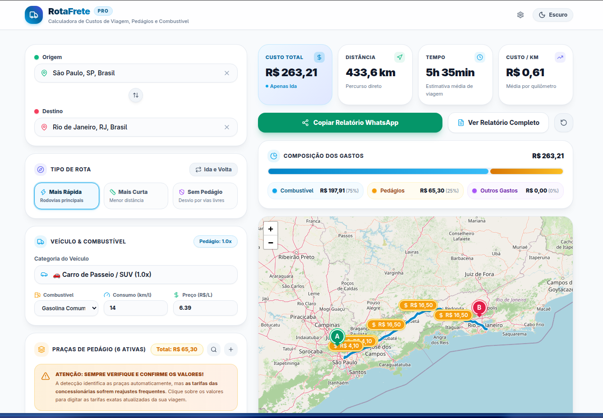

RotaFrete is a web application built with React, TypeScript, and Tailwind CSS designed for drivers, carriers, and travelers who need to accurately estimate the total costs of a road trip.

The application operates entirely client-side, requiring no authentication or centralized database storage, enabling quick export of formatted reports for sharing via WhatsApp, email, and internal systems.

[Website](https://geraldohomero.github.io/RotaFrete/)

### Key Features
* **Trip Cost Calculation:** Accurate estimation of fuel, tolls, and operational expenses.
* **Multiple Vehicle Types:** Support for cars, motorcycles, trucks, and buses.
* **100% Client-Side:** Runs completely in the browser without login or backend storage required.
* **Exportable Reports:** Fast generation of formatted reports for sharing via WhatsApp, email, or print.

Preview

  



